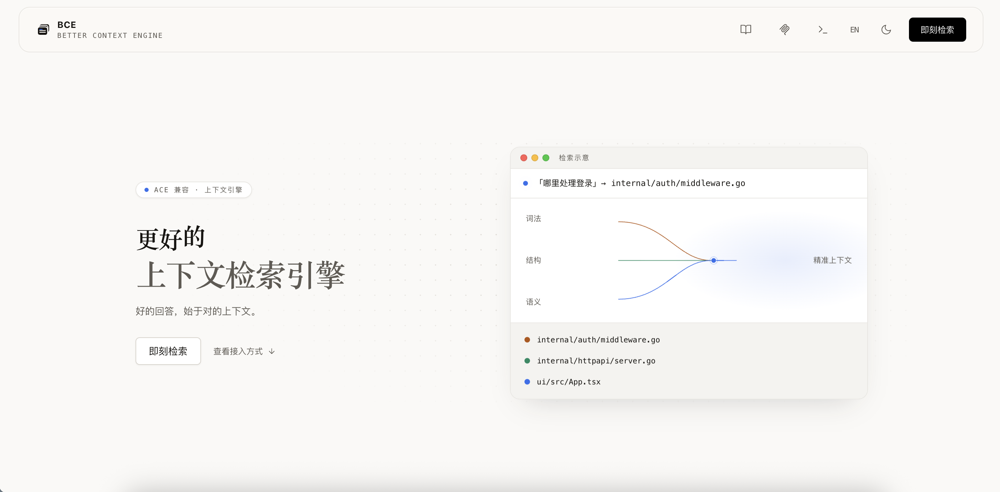
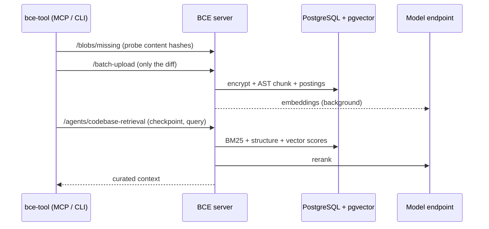
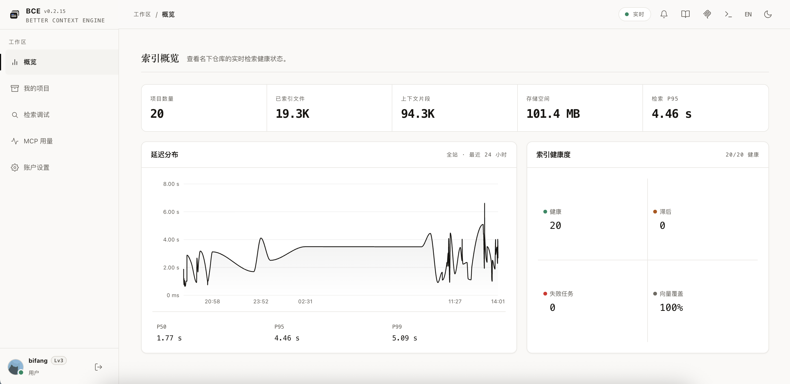
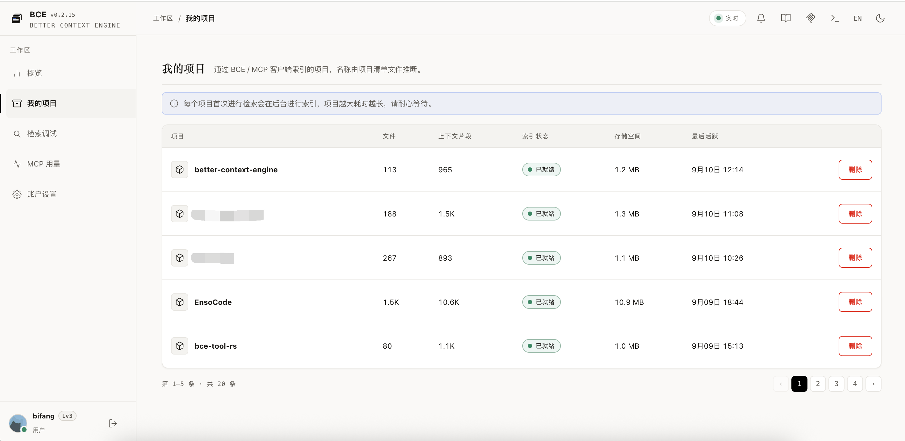
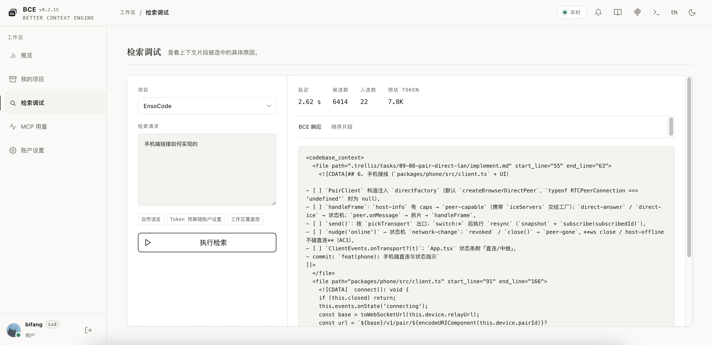
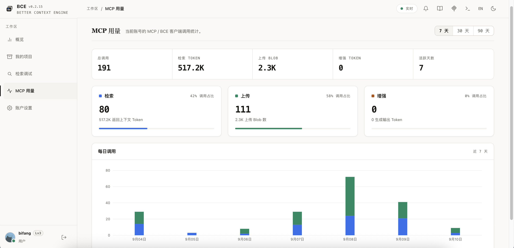
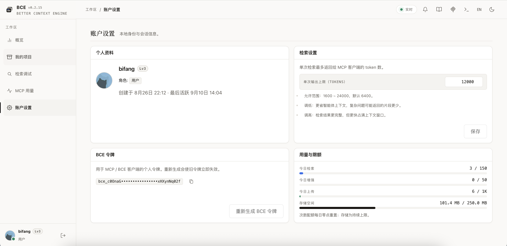

<div align="center">


# Better Context Engine

**Better context, better code.**

A self-hostable code context engine — real-time indexing, three-way recall and reranking, relevant fragments to your coding agent within five seconds.

[](go.mod) [](https://hub.docker.com/r/bifang1199/better-context-engine) [](#quick-start) [](#license)

English · [简体中文](README.zh-CN.md)

<sub>Friends · <a href="https://linux.do">🐧 LinuxDO</a></sub>

[Features](#features) · [How it works](#how-it-works) · [Screenshots](#screenshots) · [Models](#model-configuration) · [Quick start](#quick-start) · [Clients](#connecting-a-client) · [Configuration](#configuration)

</div>

---

Better Context Engine (BCE) is written in Go. It indexes codebases in real time and serves context to AI coding assistants within a 5-second latency budget. The only dependencies are PostgreSQL (with pgvector) and one model endpoint — no separate vector database, no message queue.

> [!NOTE]
> Uploaded source is encrypted at rest with AES-256-GCM. Blobs are content-addressed and deduplicated, so branches and worktrees of one repository only cost their diff.

<div align="center">
  
</div>

## Features

**Retrieval**

- **Three-way recall** – BM25 lexical search (persistent inverted index, camelCase/snake_case splitting) + path/symbol structural scoring + semantic vectors, fused with RRF.
- **Rerank & curation** – cross-encoder reranking, then per-file caps, adjacent-fragment merging and small-fragment expansion.
- **Always available** – semantic scoring runs inside PostgreSQL via pgvector; each model path degrades independently with cooldowns, so lexical/structural retrieval never goes down.
- **Request merging & cache** – concurrent identical requests collapse into one run; with Redis configured, a repeated question on the same snapshot is also served from cache.

**Indexing**

- **AST chunking** – tree-sitter structural chunks (8 language grammars, method level), with regex and sliding-window fallbacks.
- **Content addressing** – `sha256(path+content)` blobs + immutable snapshots + deterministic checkpoint IDs, deduplicated across users.
- **Model isolation** – vectors are stored per model ID; switching models backfills missing embeddings automatically.
- **Idle cleanup** – a project not searched for a set number of days has its index data purged (60 days by default; users can change or disable this in account settings).

**Integration & security**

- **Endpoints** – `/blobs/missing` (probe for missing content, upload only the diff), `/batch-upload`, `/agents/codebase-retrieval` (`410` for unknown checkpoints), `/prompt-enhancer`; compatible with ace-tool-rs-style clients.
- **Tokens & quotas** – global token + personal tokens (stored as SHA-256), per-user RPM, daily allowance and storage ceiling.
- **Sign-up & login** – self-service sign-up with email verification codes (Turnstile check, email-domain allowlist) and LinuxDo OAuth login; each entry point stays hidden until its variables are configured.
- **Hardening** – Argon2id passwords, CSRF protection, RBAC, audit log.

**Console**

- **Workspace** – overview / my projects / retrieval debugger (fragment attribution, eval cases) / MCP usage / account settings.
- **Admin** – users / analytics / all projects / MCP management / system settings (models & registration) / quotas / announcements / audit log.
- **Single binary** – English & Chinese, light & dark themes; the frontend is embedded via `go:embed`.

## Overview

| Item | Value |
| :--- | :--- |
| Server | Go 1.26 (CGO, tree-sitter) + React 17 console |
| Storage | PostgreSQL 16 + pgvector; optional Redis for rate limits and caches |
| Image | [`bifang1199/better-context-engine`](https://hub.docker.com/r/bifang1199/better-context-engine) (amd64 / arm64) |
| Clients | [bce-tool](https://github.com/linqiu919/bce-tool-rs) MCP / CLI, any ace-tool-rs-style client |
| Integrations | [dsh-bce](https://github.com/linqiu919/dsh-bce) — one-click prompt enhancement for DeepSeek Harness |
| Default port | `18181` |

## How it works



1. The client hashes the workspace and uploads only the blobs the server does not already hold.
2. Lexical postings are written on ingest, so a project is searchable immediately; vectors are filled in the background.
3. A retrieval fuses lexical, structural and semantic recall, reranks the candidates and curates the excerpts.
4. A weak first-pass match switches to broad mode: LLM sub-query decomposition, manifest priors and skeleton excerpts.

> [!IMPORTANT]
> Every retrieval runs inside a 5-second budget. Steps that would overrun it (query expansion, reranking, inline embedding) degrade instead of failing the request.

## Screenshots

| Index overview | My projects |
| :---: | :---: |
|  |  |

| Search inspect | MCP usage |
| :---: | :---: |
|  |  |

<div align="center">
  
</div>

## Model configuration

### Out-of-the-box defaults

| Path | Default model | Notes |
| :--- | :--- | :--- |
| Embedding | `Qwen/Qwen3-Embedding-8B` | 4096 dimensions |
| Reranker | `Qwen/Qwen3-Reranker-8B` | Jina/Cohere-compatible `/rerank` |
| Prompt enhancer | `Qwen/Qwen3.5-9B` | OpenAI chat protocol |
| Chunk summaries | `Qwen/Qwen3-8B` | Shares the enhancer's endpoint and key |

The default endpoint is SiliconFlow (`api.siliconflow.cn/v1`); a single `MODEL_API_KEY` covers every model path. Everything can be switched to local services (ollama/vLLM) via environment variables or the admin console. Without any model configured, retrieval runs on the lexical/structural paths only.

### Recommended setup (what the hosted instance runs)

| Path | Model | Provider |
| :--- | :--- | :--- |
| Embedding | `voyage-code-4` (1024 dims) | Voyage AI |
| Reranker | `rerank-3` (Top-K 50) | Voyage AI |
| Prompt enhancer | `google/gemini-4-hydrogen` (provider order `google-ai-studio,google-vertex`) | OpenRouter |
| Chunk summaries | `deepseek/deepseek-v4.1-flash-1017` (budget 10 per round) | OpenRouter |

Voyage's code-specialized models perform noticeably better for code retrieval. Embedding and reranker share the `https://api.voyageai.com/v1` endpoint and key, and the query/document asymmetry is handled automatically via `input_type`. The enhancer/summary path uses its own provider, configured under **System settings → Retrieval configuration**.

<details>
<summary><b>Choosing the enhancer model</b></summary>

- **One model, several jobs** – besides `/prompt-enhancer` rewrites it drives term expansion for spaceless-script (e.g. Chinese) queries and broad-query decomposition. The summary model shares its endpoint and key, so both must live on the same platform.
- **Accuracy over speed** – an enhancement is only useful if it names the actual cause (a specific constant, page size, call site) rather than listing generic things to check. Several faster, cheaper models produced rewrites that looked specific but missed the root cause, so pick the model that finds the root cause even if it is slower (the hosted instance's `gemini-4-hydrogen` takes about 7–11s of model time per call).
- **Summaries can use a faster, cheaper model** – they are high-volume one- or two-sentence descriptions that need little reasoning. The provider order is only a preference (fallbacks stay allowed), so a non-Google summary model routes fine.
- **Evaluate with questions whose answer you know** – several questions, several runs each, checking whether the rewrite hits the root cause, not just whether it cites code.
- **Mandatory-reasoning models work too** – calls through OpenRouter turn reasoning off; when a model refuses that (e.g. Gemini models), the server retries once with minimal reasoning.

</details>

## Quick start

### Docker Compose (recommended)

```bash
cp .env.example .env    # replace the secrets and API keys
docker compose up -d
```

Open [http://localhost:18181](http://localhost:18181) and sign in as `admin` (password is `BOOTSTRAP_ADMIN_PASSWORD` from your `.env`).

> [!TIP]
> For a local ollama alongside: `docker compose --profile models up -d`.

### Local development

```bash
npm install --prefix ui
npm run build --prefix ui

BOOTSTRAP_ADMIN_PASSWORD=development-admin-password \
DEMO_DATA=true \
go run ./cmd/server
```

Without `BCE_DATABASE_URL` the server uses an in-memory store.

## Connecting a client

Pick either route and point it at your BCE deployment. The first retrieval uploads and indexes the project automatically.

- **MCP** – configure `bce-tool` (or any `ace-tool-rs`-style client) in your MCP client — Cursor, Claude Code, …
- **Agent Skill** – drop [`skills/bce/SKILL.md`](skills/bce/SKILL.md) into your agent's skills directory and set `BCE_BASE_URL` and `BCE_TOKEN`; the agent runs one-shot `npx bce-tool --search` calls on demand, with no resident MCP process. The `/#skill` page of your deployment lists the skills directory for each agent.

Full setup guide: [documentation](https://bce-doc.wxnext.top).

| Token | Format | Attribution |
| :--- | :--- | :--- |
| Global | `ACE_TOKEN` | Shared; exempt from per-user quotas |
| Personal | `bce_...` (account settings page) | Usage, quotas and enhancement context follow the calling user |

## Configuration

| Variable | Default | Description |
| :--- | :--- | :--- |
| `BCE_ADDR` | `:18181` | HTTP listen address |
| `BCE_DATABASE_URL` | empty | PostgreSQL connection URL; empty = in-memory store |
| `ACE_TOKEN` | `development-token` | Global bearer token for the ACE endpoints |
| `BCE_ENCRYPTION_KEY` | empty | AES-256-GCM key for source encryption; required with PostgreSQL |
| `BOOTSTRAP_ADMIN_USERNAME` | `admin` | First administrator username |
| `BOOTSTRAP_ADMIN_PASSWORD` | generated | First administrator password; if omitted, a generated value is printed to the log |
| `COOKIE_SECURE` | `false` | Set to `true` when deployed behind HTTPS |
| `SESSION_TTL` | `24h` | Local session lifetime |
| `DEMO_DATA` | `true` | Seed a demo repository and developer account |
| `MODEL_API_KEY` | empty | Bearer key shared by every model path; local servers ignore it |
| `EMBEDDING_PROVIDER` | `openai-compatible` | `ollama` / `openai-compatible` |
| `EMBEDDING_URL` | `https://api.siliconflow.cn/v1` | Embedding service endpoint |
| `EMBEDDING_MODEL` | `Qwen/Qwen3-Embedding-8B` | Code/query embedding model |
| `EMBEDDING_DIMENSIONS` | `4096` | Vector dimensions |
| `RERANKER_MODEL` | `Qwen/Qwen3-Reranker-8B` | Cross-encoder rerank model (reuses the embedding provider's endpoint and key) |
| `RERANKER_TOP_K` | `24` | Number of fused candidates sent to the reranker |
| `ENHANCER_URL` | `https://api.siliconflow.cn/v1` | Prompt-enhancer LLM endpoint |
| `ENHANCER_MODEL` | `Qwen/Qwen3.5-9B` | Prompt-enhancer model; also drives term expansion for spaceless-script queries and broad-query decomposition |
| `SUMMARY_MODEL` | `Qwen/Qwen3-8B` | Chunk-summary model (shares the enhancer's endpoint and key); `none` turns LLM summaries off |
| `BCE_REDIS_ADDR` | empty | Optional Redis address (`host:port`) for rate limits, the retrieval cache and sign-up codes; empty keeps limits and codes in-process and disables the retrieval cache |
| `BCE_REDIS_PASSWORD` | empty | Redis password |
| `BCE_PUBLIC_URL` | empty | Public base URL (e.g. `https://bce.example.com`), used to build the OAuth callback |
| `SMTP_HOST` / `SMTP_PORT` | `smtp.gmail.com` / `587` | Mail server for sign-up verification codes |
| `SMTP_USERNAME` / `SMTP_PASSWORD` | empty | Mail account; email sign-up stays closed until set |
| `SMTP_FROM` | `SMTP_USERNAME` | Sender address |
| `TURNSTILE_SITE_KEY` / `TURNSTILE_SECRET_KEY` | empty | Cloudflare Turnstile check on sign-up |
| `LINUXDO_CLIENT_ID` / `LINUXDO_CLIENT_SECRET` | empty | LinuxDo Connect OAuth login; also needs `BCE_PUBLIC_URL`, otherwise the login button stays hidden |

## Development

```bash
go test ./...
npm run build --prefix ui
```

The production container builds the frontend first and embeds it into the server; it also ships `bce-agent`. `bce-server` is compiled with CGO because of the tree-sitter AST chunker.

## License

[PolyForm Noncommercial 1.0.0](LICENSE) — free for personal and noncommercial use (research, study, hobby projects, nonprofits, education).

> [!WARNING]
> **Commercial use requires a separate license.** Please open an issue or contact [@linqiu919](https://github.com/linqiu919).
