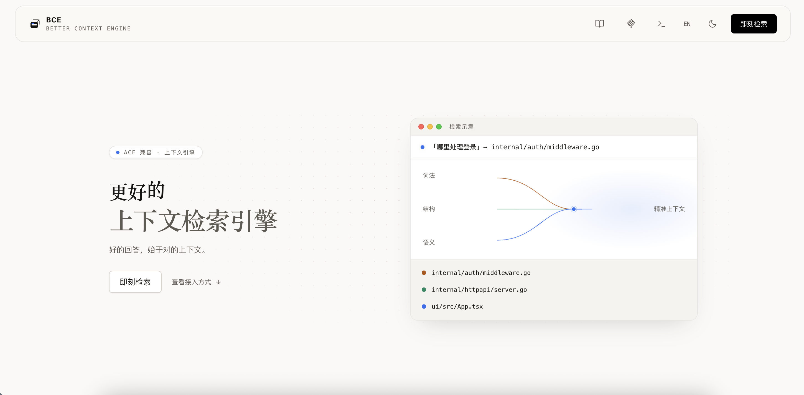
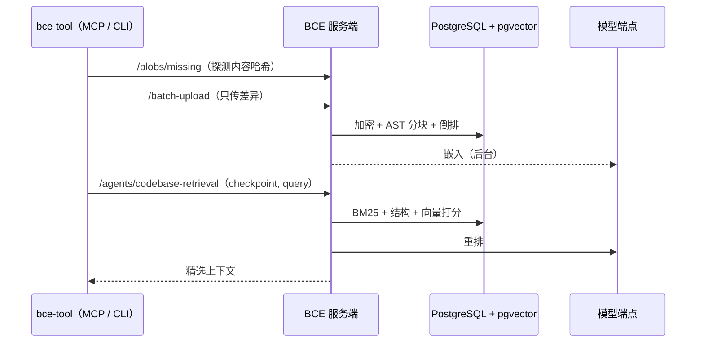
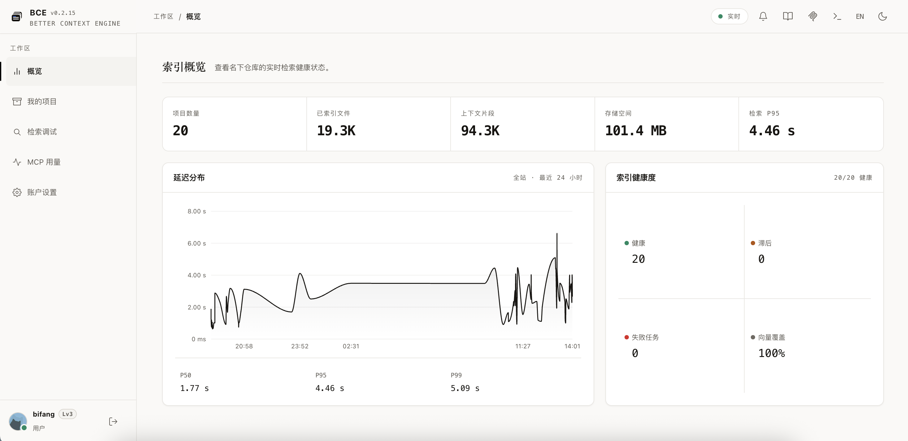
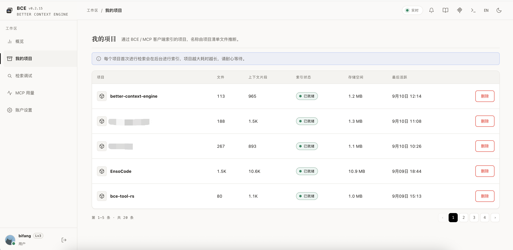
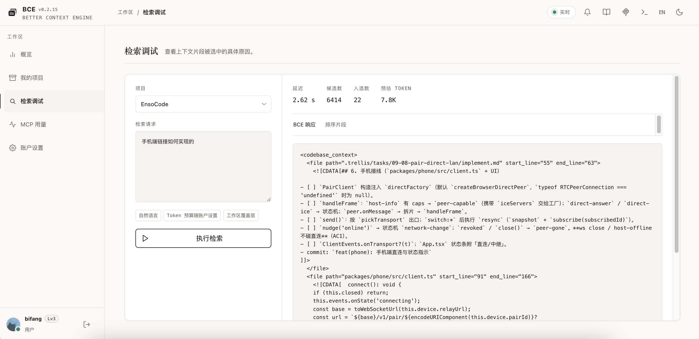
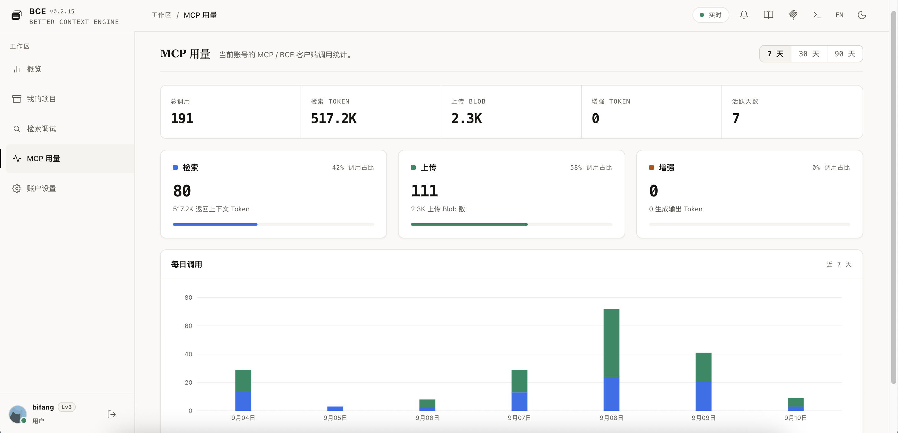
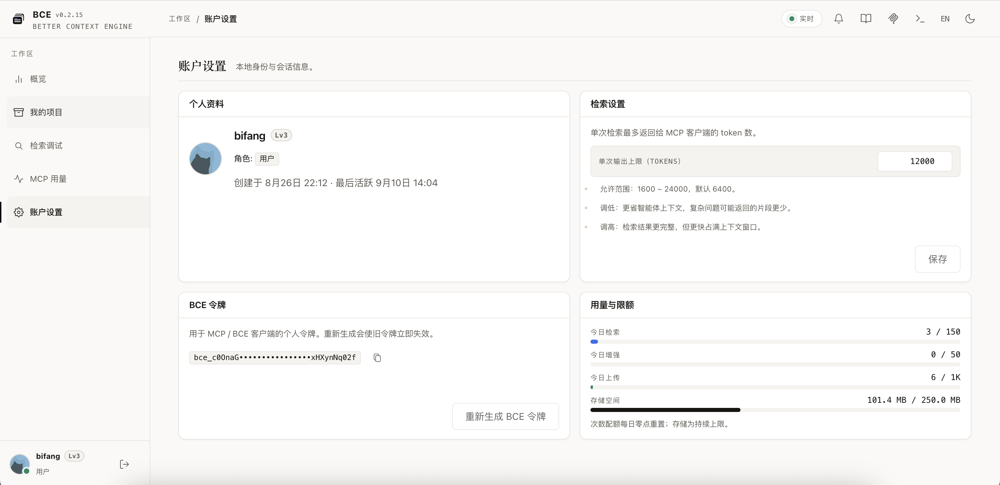

<div align="center">


# Better Context Engine

**ACE 兼容的代码上下文检索引擎：实时索引，为 AI 编程助手提供低延迟、高相关的上下文。**

[](go.mod) [](https://hub.docker.com/r/bifang1199/better-context-engine) [](#快速开始) [](#许可证)

[English](README.md) · 简体中文

<sub>友链 · <a href="https://linux.do">🐧 LinuxDO</a></sub>

[特性](#特性) · [工作原理](#工作原理) · [界面预览](#界面预览) · [模型配置](#模型配置) · [快速开始](#快速开始) · [接入方式](#接入方式) · [配置项](#配置项)

</div>

---

Better Context Engine（BCE）以 Go 编写，实时索引代码库，在 5 秒延迟预算内为 AI 编程助手返回上下文。只依赖 PostgreSQL（含 pgvector）与一个模型端点，无需独立向量数据库和消息队列。

> [!NOTE]
> 上传的源码以 AES-256-GCM 加密落库。blob 按内容寻址去重，同一仓库的分支与 worktree 只按差异占用存储。

<div align="center">
  
</div>

## 特性

**检索**

- **三路召回** – BM25 词法（持久化倒排索引，camelCase/snake_case 拆分）+ 路径/符号结构打分 + 语义向量，RRF 融合。
- **重排与精选** – 交叉编码器重排，再做每文件上限、相邻片段合并、小片段扩展。
- **始终可用** – 语义打分经 pgvector 在库内完成；各模型通路独立冷却降级，词法/结构两路始终可用。

**索引**

- **AST 分块** – tree-sitter 结构分块（8 种语言 grammar，方法级），正则、滑窗两级兜底。
- **内容寻址** – `sha256(path+content)` blob + 不可变快照 + 确定性 checkpoint ID，跨用户去重。
- **模型隔离** – 向量按模型 ID 存储，切换模型后缺失向量自动补嵌。

**接入与安全**

- **ACE 端点** – `/batch-upload`、`/agents/codebase-retrieval`（未知 checkpoint 返回 `410`）、`/prompt-enhancer`，兼容 ace-tool-rs 类客户端。
- **令牌与配额** – 全局令牌 + 个人令牌（SHA-256 存储），按用户限 RPM、每日次数与存储上限。
- **安全加固** – Argon2id 密码、CSRF 防护、RBAC、审计日志。

**控制台**

- **工作区** – 概览 / 我的项目 / 检索调试（片段归因、评测用例）/ MCP 用量 / 账户设置。
- **管理后台** – 用户管理 / 全部项目 / 系统设置（模型与注册开关）/ 配额与限流 / 公告管理 / 审计日志。
- **单二进制** – 中英双语、明暗主题；前端经 `go:embed` 嵌入。

## 概览

| 项目 | 说明 |
| :--- | :--- |
| 服务端 | Go 1.26（CGO，tree-sitter）+ React 17 控制台 |
| 存储 | PostgreSQL 16 + pgvector；可选 Redis 用于限流与缓存 |
| 镜像 | [`bifang1199/better-context-engine`](https://hub.docker.com/r/bifang1199/better-context-engine)（amd64 / arm64） |
| 客户端 | [bce-tool](https://github.com/linqiu919/bce-tool-rs) MCP / CLI，或任意 ace-tool-rs 类客户端 |
| 生态 | [dsh-bce](https://github.com/linqiu919/dsh-bce) — DeepSeek Harness 一键提示增强插件 |
| 默认端口 | `18181` |

## 工作原理



1. 客户端对工作区计算哈希，只上传服务端尚未持有的 blob。
2. 入库时先写词法倒排，项目立即可检索；向量在后台补齐。
3. 检索融合词法、结构、语义三路召回，重排后精选片段输出。
4. 首轮匹配偏弱时进入宽泛模式：LLM 子查询分解、清单文件结构先验、骨架化摘录。

> [!IMPORTANT]
> 每次检索受 5 秒总预算约束；会超预算的环节（词扩展、重排、内联补嵌）降级而不让请求失败。

## 界面预览

| 索引概览 | 我的项目 |
| :---: | :---: |
|  |  |

| 检索调试 | MCP 用量 |
| :---: | :---: |
|  |  |

<div align="center">
  
</div>

## 模型配置

### 出厂默认

| 通路 | 默认模型 | 说明 |
| :--- | :--- | :--- |
| Embedding | `Qwen/Qwen3-Embedding-8B` | 4096 维 |
| 重排 | `Qwen/Qwen3-Reranker-8B` | Jina/Cohere 兼容 `/rerank` |
| 提示增强 | `Qwen/Qwen3.5-9B` | OpenAI chat 协议 |

默认端点为硅基流动（`api.siliconflow.cn/v1`），一个 `MODEL_API_KEY` 覆盖三条通路；均可经环境变量或管理员控制台改为本地服务（ollama/vLLM）。不配模型时检索仅走词法/结构两路。

### 推荐配置（官方实例同款）

| 通路 | 模型 | 提供方 |
| :--- | :--- | :--- |
| Embedding | `voyage-code-4`（1024 维） | Voyage AI |
| 重排 | `rerank-2.5`（Top-K 50） | Voyage AI |
| 提示增强 | `google/gemini-3.8-flash` | OpenRouter |
| 代码摘要 | `google/gemini-3.8-flash` | OpenRouter |

Voyage 的代码专用模型在代码检索场景表现更好。嵌入与重排共用 `https://api.voyageai.com/v1` 端点和 Key，query/document 非对称经 `input_type` 自动处理。增强与摘要走独立提供方，在 **系统设置 → 检索设置** 中配置。

<details>
<summary><b>增强模型选型建议</b></summary>

- **同一个模型身兼数职** – 除 `/prompt-enhancer` 改写外，还负责检索中的中文词扩展、宽泛查询子查询分解；摘要模型与它共用同一地址和 Key（不能分属两个平台）。
- **准确优先于速度** – 增强的价值在于点出真正的问题所在（具体常量、条数、调用点），而不是罗列泛泛的排查方向。实测不少更快更便宜的模型会写出看似具体、实则偏离根因的改写；`gemini-3.8-flash` 慢一些（单次约 5–10s），但在对比中更能点中根因。
- **用"已知答案"的真实问题评测** – 多个问题、每个多跑几次，核对改写是否命中根因，而不只看是否引用了代码。
- **强制思考的模型也能用** – 经 OpenRouter 调用时默认关闭思考；若模型不允许关闭（如 Gemini 3.x），服务端自动改用最低思考档重试一次。

</details>

## 快速开始

### Docker Compose（推荐）

```bash
cp .env.example .env    # 替换其中的密钥与 API Key
docker compose up -d
```

打开 [http://localhost:18181](http://localhost:18181)，用 `admin` 登录（密码为 `.env` 中的 `BOOTSTRAP_ADMIN_PASSWORD`）。

> [!TIP]
> 需要本地 ollama 时：`docker compose --profile models up -d`。

### 本地开发

```bash
npm install --prefix ui
npm run build --prefix ui

BOOTSTRAP_ADMIN_PASSWORD=development-admin-password \
DEMO_DATA=true \
go run ./cmd/server
```

未设置 `BCE_DATABASE_URL` 时使用内存存储。

## 接入方式

在 MCP 客户端（Cursor、Claude Code 等）中配置 `bce-tool`（或任意 `ace-tool-rs` 类客户端），服务地址指向 BCE 部署地址即可。首次检索会自动上传并索引项目，无需手动导入。

| 令牌 | 格式 | 归属 |
| :--- | :--- | :--- |
| 全局令牌 | `ACE_TOKEN` | 共享，不受按用户配额限制 |
| 个人令牌 | `bce_...`（账户设置页生成） | 用量、配额与增强上下文归属调用用户 |

## 配置项

| 变量 | 默认值 | 说明 |
| :--- | :--- | :--- |
| `BCE_ADDR` | `:18181` | HTTP 监听地址 |
| `BCE_DATABASE_URL` | 空 | PostgreSQL 连接 URL；留空使用内存存储 |
| `ACE_TOKEN` | `development-token` | ACE 端点的全局 Bearer Token |
| `BCE_ENCRYPTION_KEY` | 空 | AES-256-GCM 源码加密密钥；使用 PostgreSQL 时必填 |
| `BOOTSTRAP_ADMIN_USERNAME` | `admin` | 首个管理员用户名 |
| `BOOTSTRAP_ADMIN_PASSWORD` | 自动生成 | 首个管理员密码；省略时生成值打印到日志 |
| `COOKIE_SECURE` | `false` | 部署在 HTTPS 之后时设为 `true` |
| `SESSION_TTL` | `24h` | 本地会话有效期 |
| `DEMO_DATA` | `true` | 播种演示仓库与开发者账户 |
| `MODEL_API_KEY` | 空 | 三条模型通路共享的 Bearer Key；本地服务忽略 |
| `EMBEDDING_PROVIDER` | `openai-compatible` | 可选 `ollama` / `openai-compatible` |
| `EMBEDDING_URL` | `https://api.siliconflow.cn/v1` | Embedding 服务端点 |
| `EMBEDDING_MODEL` | `Qwen/Qwen3-Embedding-8B` | 代码/查询嵌入模型 |
| `EMBEDDING_DIMENSIONS` | `4096` | 向量维度 |
| `RERANKER_MODEL` | `Qwen/Qwen3-Reranker-8B` | 交叉编码器重排模型（复用嵌入提供商的端点与 Key） |
| `RERANKER_TOP_K` | `24` | 送入重排的融合候选数量 |
| `ENHANCER_URL` | `https://api.siliconflow.cn/v1` | 提示增强 LLM 端点 |
| `ENHANCER_MODEL` | `Qwen/Qwen3.5-9B` | 提示增强模型；留空则 `/prompt-enhancer` 返回 501 |

## 开发

```bash
go test ./...
npm run build --prefix ui
```

生产容器先构建前端再嵌入服务端，同时包含 `bce-agent`；`bce-server` 因 tree-sitter AST 分块器以 CGO 编译。

## 许可证

[PolyForm Noncommercial 1.0.0](LICENSE)——个人与非商业用途免费（研究、学习、个人项目、公益组织、教育机构等）。

> [!WARNING]
> **商业用途需单独授权**，请提 issue 或联系 [@linqiu919](https://github.com/linqiu919) 洽谈商业许可。
